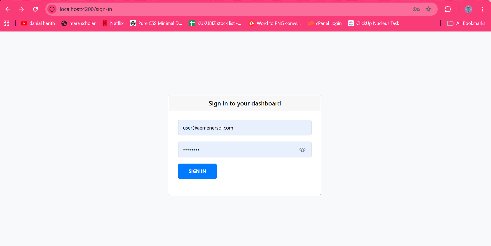
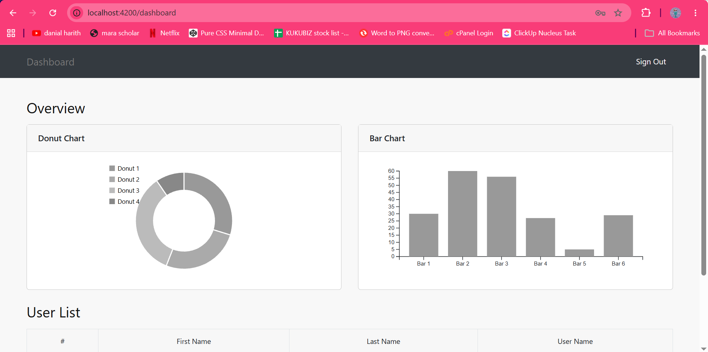

# AEM Norfadilatul Web App

**A Responsive Angular Dashboard Application**

A web application built with Angular 14, featuring authentication, protected routes, interactive data visualization, responsive page layouts, and an enhanced sign-in experience.

## Overview

AEM Norfadilatul Web App is a dashboard application developed as part of a technical assessment. The project demonstrates frontend application development using Angular, REST API integration, authentication workflows, and responsive user interface design.

The application combines dashboard data visualization with a structured user interface designed to provide a consistent experience across desktop, tablet, and mobile screen sizes.

## Key Features

### Authentication & Navigation

* **API-Based Authentication** — Integrates with a backend REST API for sign-in.
* **Protected Routes** — Uses Angular route guards to restrict access to protected pages.
* **HTTP Interceptor** — Centralizes HTTP request handling and supports attaching authentication tokens when available.
* **Show/Hide Password** — Includes a password visibility toggle on the sign-in form, allowing users to reveal or conceal their password while entering credentials.
* **Form Validation** — Supports form-level validation to improve the sign-in experience.

### Dashboard & Data Visualization

* **Interactive Donut Chart** — Visualizes dashboard data using D3.js.
* **Bar Chart** — Presents data comparisons in a visual format.
* **User Data Table** — Displays user information in a structured table.
* **REST API Integration** — Retrieves dashboard information from the configured backend service.

### Responsive UI/UX

* **Responsive Pages** — Adapts page layouts to desktop, tablet, and mobile screen sizes.
* **Bootstrap Layout** — Uses Bootstrap components and grid utilities to organize content.
* **Responsive Dashboard Components** — Structures charts, navigation, and tabular data for different viewport sizes.
* **Improved Sign-In Usability** — Provides a convenient password visibility control during authentication.

## Screenshots

Add screenshots of the actual application here to showcase the interface.

### Sign-In Page

<!-- Save your screenshot as screenshots/login.png -->



### Dashboard

<!-- Save your screenshot as screenshots/dashboard.png -->



> If screenshots are not available yet, remove the image links above until the files have been added to the repository.

## Technologies Used

| Technology      | Purpose                                             |
| --------------- | --------------------------------------------------- |
| Angular 14      | Frontend framework                                  |
| TypeScript      | Application logic and type safety                   |
| RxJS            | Reactive programming and asynchronous data handling |
| Angular Router  | Application navigation and route guards             |
| D3.js           | Dashboard charts and data visualization             |
| Bootstrap 4     | Responsive layouts and UI components                |
| Bootstrap Icons | Interface icons                                     |
| REST API        | Backend authentication and dashboard data           |

## Application Architecture

The project organizes functionality into dedicated application areas to improve maintainability and separation of concerns.

* **Core Services** — Handles authentication and dashboard data access.
* **Route Guards** — Controls access to protected application routes.
* **HTTP Interceptors** — Applies shared request-handling logic.
* **Feature Components** — Separates sign-in and dashboard interfaces.
* **Dashboard Visualization** — Renders charts and presents user data.

## Getting Started

### Prerequisites

Install the following tools before running the application:

* Node.js compatible with Angular 14
* npm
* Git

### 1. Clone the Repository

```bash
git clone https://github.com/wanieyfadzil/AEM_Norfadilatul_webApp.git
```

### 2. Navigate to the Project

```bash
cd AEM_Norfadilatul_webApp
```

### 3. Install Dependencies

```bash
npm install
```

### 4. Start the Development Server

```bash
npm start
```

Open the following URL in your browser:

http://localhost:4200

The development server reloads the application when source files are updated.

## Build

Generate a production build with:

```bash
npm run build
```

The generated build artifacts are written to the configured Angular output directory under `dist/`.

## Testing

Run the project's unit tests with:

```bash
npm test
```

## Project Structure

```text
AEM_Norfadilatul_webApp/
├── src/
│   ├── app/
│   │   ├── core/
│   │   │   ├── guards/
│   │   │   ├── interceptors/
│   │   │   └── services/
│   │   ├── features/
│   │   │   ├── sign-in/
│   │   │   └── dashboard/
│   │   └── app-routing.module.ts
│   ├── assets/
│   └── environments/
├── angular.json
├── package.json
├── package-lock.json
├── tsconfig.json
└── README.md
```

The structure represents the main application areas; the exact folder names may vary with the current implementation.

## Security Considerations

* Authentication is integrated with the configured backend API.
* Frontend route guards improve navigation control but do not replace server-side authorization.
* The password visibility toggle changes how the password is displayed; it does not change the authentication process.
* Sensitive credentials and authentication tokens should not be committed to the repository.

## Future Improvements

Potential enhancements include:

* Automated unit and integration test coverage.
* Improved loading, empty, and API error states.
* Further accessibility improvements for form controls and interactive charts.
* Additional dashboard filtering and data exploration capabilities.

## Author

**Waniey Fadzil**

GitHub: [@wanieyfadzil](https://github.com/wanieyfadzil)

## License

Developed for technical assessment purposes. No license has been specified.
